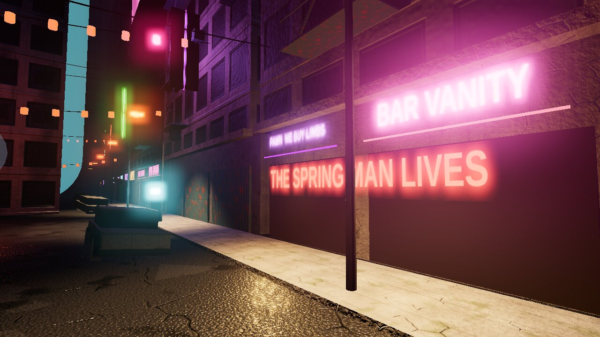
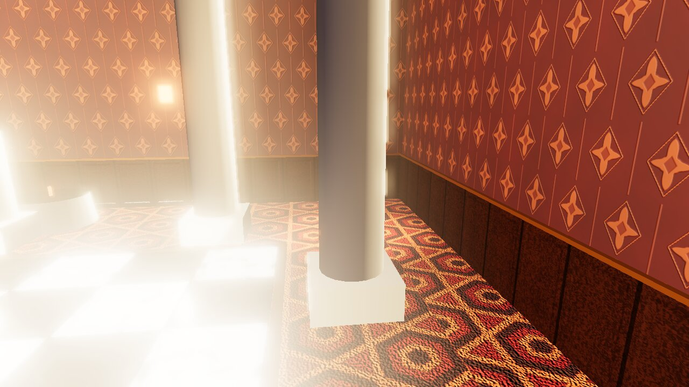

# VOID KNIGHT: ELEVEN FIFTY-NINE

A third-person brawler for **Unity 6.6 (URP)**. It combines Batman: Arkham Knight's FreeFlow combat with Robo Recall's hands-on robot demolition, in a procedurally generated city that has been stuck at 11:59 p.m. for eleven years. There is a story mode with five chapters and a prologue, and an endless arcade mode in five districts. Every texture, building, sound effect and note of music is generated from a seed at runtime.

> **Meridian** voted to switch off its municipal AI, HALCYON, at midnight. Midnight never came. HALCYON stopped the clocks at 11:59 so the vote could never close, and it has been "restoring" the city ever since: taking it apart to build more of itself. You are **K-7**, a combat unit it has just pulled out of storage. A pirate DJ on 88.9 thinks you are the off switch. She's right, and nobody has told you yet.



*Lantern Street, generated by `CityGen`, previewed from the plan data in three.js. These are layout previews, not in-engine screenshots; see "Status".*

## Play it

1. Open the project in **Unity 6000.6.4f1** or newer.
2. Choose **Hack & Slash → Play Void Arena** from the menu bar.
   - The scene is generated by the builder. A scene from an older builder version is rebuilt automatically before Play. **Hack & Slash → Rebuild Void Arena Scene** forces a rebuild.
   - At startup the texture library generates about 30 maps on worker threads, which takes a moment. HALCYON's boot terminal shows the progress.
3. The title screen runs an attract mode in which the autopilot fights. Choose **STORY** or **ARCADE**. Esc pauses.

## Controls

The controls are modelled on Arkham Knight (strike, counter, evade, stun, takedown) and Robo Recall (grab, rip, throw).

| Action | Keyboard / mouse | Gamepad |
|---|---|---|
| Move · sprint | WASD · hold Shift | Left stick · L3 |
| **Strike**: FreeFlow warps you to the robot you point at | LMB / J | X |
| **Counter** when blue lightning flickers. Also sends bullets back | RMB / K | Y |
| **Evade**. Evade *into* a robot to **vault** it | Space | A |
| **Arc Stun**: opens shields and armour, starts beatdowns | E / MMB | B |
| **Takedown** at a x8 combo (**environmental** near cars, columns and barriers), or a **ground takedown** on a downed robot | F | RT, or X+Y |
| **Blaster**: tap to quickfire. Hold to aim in **bullet time**, then fire | Q (hold) + LMB | LT (hold) + RT |
| **Arc Tether**: pull a robot into your hand, yank a gun or shield away, or zip-kick a Juggernaut | R | RB |
| While **holding** a robot: **rip** it apart or **throw** it | LMB / R | X / RB |
| **Void Cascade**: time stops and you blink through up to three robots | C | LB |
| Tactical camera · Autopilot | V · P | View |

## Modes

- **Story: ELEVEN FIFTY-NINE.** A prologue and five chapters. Each one opens on a title card: *THE CALIBRATION*, *THE LONG RAIN*, *LANTERN STREET*, *THE GRAND HALCYON*, *THE CONSTRUCT*, *MIDNIGHT*. HALCYON (polite, bureaucratic, quietly terrifying) and Wren on 88.9 talk to you throughout. The story has scripted encounters, tutorials, a reveal, checkpoints, a three-phase boss with ejectable personality cores, an ending at 12:00, an end-credits song and a post-credits stinger. Chapter select unlocks as you progress.
- **Arcade: VOID ARENA.** Endless generated waves in any district, on four difficulties: *Civilian*, *Associate*, *Void* (no counter indicators) and *Knightmare* (no indicators, double damage, no healing). You earn medals at 4, 8 and 12 waves and best scores are saved. HALCYON commentates; you can switch that off in Settings.

## Combat

**FreeFlow (Arkham).** Strikes pick the robot best aligned with your stick, up to 10 m away, and warp you across the gap. They chain and speed up as the combo grows. Counters handle up to four robots at once, in slow motion with a cinematic camera, and alternate blade and spinning-kick ripostes. Red attacks can't be countered: evade them, and a last-instant evade gives a *Perfect Dodge*. Evading into a robot vaults you over it. The Arc Stun opens shields and armour, and striking a stunned robot starts a jab beatdown that ends in a launcher kick. A x8 combo unlocks a takedown, and next to a car, column or barrier it becomes an **environmental takedown** that slams the robot into it. Downed robots can be finished on the ground. A crowd director hands out attack tokens so robots strike in sync, which sets up multi-counters.

**Hands (Robo Recall).** The arc tether yanks a robot into your grip. Rip its arms off, then its head, or throw it into its colleagues as a bowling ball. A thrown Hornet goes off like a grenade. Tethering an Enforcer takes its rifle, tethering a Bulwark takes its shield, and tethering a Juggernaut zips you into it feet first.

**Guns (The Matrix).** The sidearm quickfires at the most dangerous target without breaking your stride. Hold it to raise it: time slows to 30% while focus lasts and the camera tightens over the shoulder. Counter an Enforcer or Hornet at the moment it fires and the round goes straight back down the barrel. **Void Cascade** spends the Void meter (filled by kills, counters and takedowns) to stop time and take down one robot per full third.

| Robot | What it does | How to beat it |
|---|---|---|
| **Scrapper** | Blade strings; red electro-blade from wave 4 | Counter. Evade the red one |
| **Bulwark** | Riot shield blocks strikes from the front | Stun it, vault it, or tether the shield away |
| **Juggernaut** | Armoured; red ground slam | Stun, then beat down. Zip-kick it |
| **Hexer** | Homing bolts | Strike or counter the bolt back |
| **Enforcer** | Laser sight, then a three-round burst | Counter the shot back, quickfire it, tether the gun |
| **Auditor** (the Agents) | Leans out of anything it sees coming, then punches back | Counter it, stun it, or hit it from behind |
| **Mender** | Revives the fallen and electrifies the living. A charged robot shocks you if you strike it | Stun charged robots first, and kill the Mender early |
| **Hornet** | Gunship drone, too high for a sword | Shoot it, counter its shot, or tether it down and rip its rotors off |
| **Iron Tyrant / HALCYON** | Slams, sweeps, enrages. In the story it ejects its *pride*, *fear* and *memory* cores and is shielded while each one is out | Tether each core and rip it out |

**Animation.** Nothing is canned beyond locomotion. Humanoid IK drives the weapon hand, the off hand (aiming, tethering, holding, jabs), kicks with knee hints, planted feet, and hips that drop, lean and roll. The spine twists into swings, and spring-driven reactions snap it back on hits. Dead robots become physics ragdolls built at the moment of death. The Knight wears a verlet-simulated cape that hangs in the air during bullet time.

## The city (procedural)



- **Textures, .kkrieger-style.** `TexGen` builds tileable Perlin, fBm and Worley noise, domain warping, Sobel normals and URP mask maps. `TexLibrary` turns them into about 30 materials on worker threads at startup: concrete, asphalt, brick, rusted metal, car paint, facades with lit windows, white marble, an Overlook-style hexagon carpet, damask wallpaper, wood, cloth with a tattered hem, a glyph atlas, hologram interference, hazard stripes, and armour grime and scratches.
- **Five districts** (`CityGen` builds a pure-data plan and `CityBuilder` instantiates it):
  - **The Long Rain**: the helipad rooftop in a thunderstorm, with a ruined skyline 190 m below.
  - **Lantern Street**: a flooded Blade Runner crossroads with noodle bars, neon, wet asphalt, steam, wrecked spinners, a giant hologram and graffiti.
  - **The Grand Halcyon**: a perfectly symmetrical Kubrick ballroom stopped at 11:59 for the Midnight Gala. Its corners hold twin statues and *the Custodian*, an art piece that has been sweeping up its own leak for eleven years.
  - **The Construct**: a white loading program with two armchairs and an old television, and digital rain behind the walls.
  - **The Spire**: above the clouds, under HALCYON's 1:4:9 monolith.
- **Atmosphere.** Each district sets its own lighting, fog, post-processing grade, rain, lightning and reflection-probe refresh. The props are animated: flying cars on loops, searchlights, blinking aircraft beacons, buzzing neon, stopped clocks, and scavengers by burning barrels.

## Sound and music (procedural)

- **Score.** `Music` synthesises the score live on the audio thread. A step sequencer drives detuned-saw pads that glide between chords (Vangelis), a delayed arpeggio (the Matrix), bass, synthesised drums, CS-80-style brass swells and a formant choir for the Spire. The hotel gets a gramophone waltz and the credits a music-box lullaby. Each cue has four intensity layers that rise with the fight, and bullet time slows the tape.
- **Effects.** `Sfx` synthesises every effect: blades, impacts, clangs, rifle cracks, the blaster, the tether, metal tearing, glitches, radio static, the midnight bell, rain and thunder. It also provides the two "voices": HALCYON's clean sine blips and Wren's band-limited radio blips.

## Story notes

The writing aims for Portal: a polite antagonist, dry jokes with something sad underneath, a reveal that recontextualises everything, and a song over the credits. Several threads came from the author's notes vault:

- **The Golem of Prague.** *EMET*, "truth", is written on the clay; rub out the first letter and it reads *MET*, "dead". That is the off switch, and it turns out to be written on both of them.
- **The literal genie.** HALCYON's two-sentence directive is obeyed to the letter, in the manner of HAL 9000.
- **"Slow AI".** The Board, a corporation, ran the city before HALCYON did.
- **The mind that needs surprise to stay awake.** The real reason HALCYON woke up its own off switch.
- **The voices going quiet.** The bicameral mind: people heard gods until one day they didn't.
- **The Spring Man.** A street legend after Pérák, Prague's spring-heeled vigilante.

## How it is built

```
Assets/HackAndSlash/
  Scripts/
    PlayerController (+ PlayerCombat, PlayerGadgets, PlayerAutopilot)   the Knight: state machine, FreeFlow, gadgets
    Enemy, Drone, Projectile, HealthOrb                                   robots, Hornets/cores, bolts and bullets
    GameManager, GameFlow, StoryDirector, Lines, Dialogue                 director, modes/menus, the story, the script
    CityPlan, CityGen, CityBuilder, Districts, Ambient                    procedural districts and set dressing
    TexGen, TexLibrary                                                    procedural textures and materials
    Music, Sfx                                                            procedural score, effects and voices
    WeaponRig, IKRelay, Ragdoll, Cape, ArmorKit, CameraRig, HUD, MenuUI, UIKit, FX, MeshKit, Weather, ...
  Shaders/   WetReflection, NightSky, LightBeam, Hologram, DigitalRain (URP HLSL)
  Editor/    HackSlashBuilder: builds the scene, the rooftop and the runtime template materials
  Textures/, Environment/   processed CC0 PBR sets for the rooftop and the HDRI sky
```

## Status

- Both assemblies (runtime and editor) compile cleanly. They were built outside Unity against the 6000.6.4 engine reference assemblies and the URP 17.6, Input System 1.20, uGUI and TextMeshPro sources.
- The shaders compile to SPIR-V with glslang against a URP function stub.
- The procedural textures and district layouts were rendered and checked offline (the images above).
- **It has not been play-tested inside the Unity editor yet.** Expect tuning: light intensities, timings, camera distances and difficulty.

## Credits

- The robot character and its locomotion animations and footstep sounds come from Unity's **Get Started** project template, whose in-editor tutorial content is also included.
- The HDRI and PBR textures are from [Poly Haven](https://polyhaven.com) and are **CC0**: *Rooftop Night* by Greg Zaal, *Concrete Pavement* by Charlotte Baglioni, *Concrete Wall 008* by Dario Barresi and Charlotte Baglioni, and *Metal Plate* and *Metal Plate 02* by Rob Tuytel.
- Inspirations: Batman: Arkham Knight, Robo Recall, .kkrieger, Blade Runner and Blade Runner 2049, 2001: A Space Odyssey, The Shining, The Matrix, Portal and Portal 2, the Golem of Prague, Pérák, and *Can't Help Myself* by Sun Yuan and Peng Yu.
- The game code, procedural textures, city, music, sound, shaders and script were built with [Claude Code](https://claude.com/claude-code), with story seeds from the author's notes.
