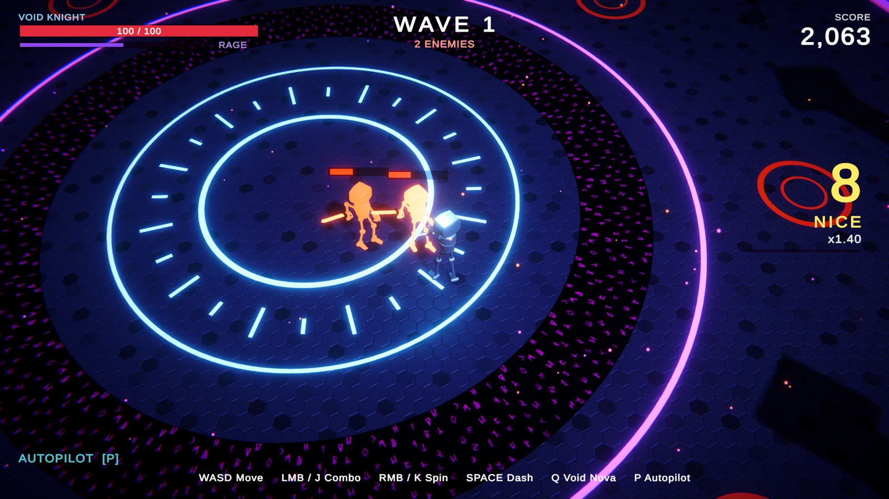

# Void Arena

A rain-soaked rooftop brawler for **Unity 6.6 (URP)**: Arkham-style FreeFlow combat against armoured robots that come apart like the ones in Robo Recall. You are the Void Knight, fighting waves of robots on a skyscraper helipad above a neon city at night. Every fifth wave the Iron Tyrant drops out of the sky.

> The screenshots below are from the previous version (top-down camera, void arena). The scene is now regenerated by the builder; see "Play it".



## Play it

1. Open the project in **Unity 6000.6.4f1** or newer (Universal Render Pipeline).
2. In the menu bar, choose **Hack & Slash → Play Void Arena**.
   - The first time, this regenerates `Assets/HackAndSlash/Scenes/VoidArena.unity` (the builder notices the committed scene is from an older version). Pressing Play in a stale Void Arena scene also rebuilds it first.
   - You can force a rebuild with **Hack & Slash → Rebuild Void Arena Scene**.
3. Click the Game view to capture the mouse. Esc releases it.

| Action | Keyboard / mouse | Gamepad |
|---|---|---|
| Move | WASD | Left stick |
| Camera | Mouse | Right stick |
| **Strike** (freeflow: warps to the robot you point at) | Left mouse / J | X / Square |
| **Counter** (when blue lightning flickers over a robot) | Right mouse / K | Y / Triangle |
| **Evade**. Evade *into* a robot to **vault** over it | Space / Shift | A / Cross |
| **Arc Stun** (cape stun: opens shields, armour and beatdowns) | E / Middle mouse | B / Circle |
| **Takedown** (at combo x8) or **Ground Takedown** (on a downed robot) | F | RB |
| Void Nova (full rage bar) | Q | RT / LB |
| Tactical top-down camera | V | — |
| Autopilot (the AI plays) | P | — |
| Restart after death | R / Enter | Start |

## FreeFlow combat (the Arkham part)

- **Directional freeflow strikes.** Strike picks the robot best aligned with your stick, up to 10 m away, and lunges across the gap. Strikes chain into each other and get faster as the combo grows. Swinging at nothing breaks the combo.
- **Counters and multi-counters.** Each melee attack shows a *spider-sense* glyph above the attacker. Counter in that window to parry and riposte (the robot is knocked down). If two to four robots swing together, one press counters all of them: you warp between them in slow motion. Counters have a lockout, so spamming doesn't work.
- **Red attacks can't be countered.** The Juggernaut slam, the Tyrant slam, and some Scrapper electro-blade attacks from wave 4 on show a red glyph and a ground warning. Evade them; a last-moment evade triggers *Perfect Dodge* slow motion.
- **Evade and vault.** Evading toward a nearby robot flips you over it, and the robot loses track of you.
- **Arc Stun and beatdowns.** Stun everything in front of you. Stunned robots can't attack, and strikes on them become a fast beatdown.
- **Enemy types that need specific moves.**
  - **Bulwark** (new): its riot shield blocks frontal strikes. Stun it or vault behind it.
  - **Juggernaut**: armoured, so strikes do chip damage only. Stun it, then beat it down.
  - **Hexer**: fires homing bolts. Counter or strike a bolt to send it back.
  - **Iron Tyrant**: slams (red), sweeping hammer swings (blue, counterable), becomes enraged at half health, and can be stunned.
- **Special-combo takedowns.** Eight hits in a row light up the meter. Takedown then executes a robot (or takes 20% off the boss) in a cinematic: slow motion, letterbox and depth of field. Knocked-down robots can be finished with a ground takedown, but you're exposed while you do it.
- **The crowd director.** Robots circle you at different distances and strafe. A director gives attack tokens to groups of one to three, often in sync so multi-counters happen, and the pace rises each wave.
- **Arkham's wave-end bonuses.** You get *Flawless FreeFlow* if you weren't hit, and *Variation* for using five or more different moves. The last robot of each wave dies in a slow-motion close-up.
- **Game feel.** Hit-stop, trauma camera shake, FOV punches, gamepad rumble, procedural torso twist into every swing, and an autopilot attract mode that plays this way too (it counters, stuns, vaults and does takedowns).

## Photoreal rooftop (the Robo Recall part)

- **Armoured robots built on the rig.** `ArmorKit` bolts bevelled hard-surface plates onto the humanoid bones at runtime, fitted to the bind-pose bone lengths: helmet with emissive visor, chest, back pack, pauldrons, gauntlets, thigh and shin guards, ball joints and boots. Plates use URP Complex Lit clear-coat paint with a panel-line normal map. Each faction has its own palette (pearl-white hero, Robo Recall-style worker bots, black-chrome Hexers, riot-blue Bulwarks, hazard-yellow Juggernauts, gold-chrome Tyrant).
- **They come apart.** Heavy hits chip plates off, and those plates become real rigid bodies that clatter on the roof. Kills decapitate or tear off forearms. Severed joints spray sparks and flicker, weapons drop, and the wreck topples over and powers down.
- **Wet, reflective roof.** CC0 concrete pavers are processed so puddles pool in the slab joints. A planar reflection camera mirrors the scene (characters, neon, floodlights, sky) into a screen-space overlay shader (`VoidArena/WetReflection`) that is masked by the puddles and a Fresnel term and distorted by rain.
- **Storm.** Wind-slanted rain follows the camera. Splashes and expanding ripple rings cover the roof. Lightning flashes the HDRI sky, throws a bolt onto the skyline, and thunder follows.
- **Image-based lighting.** The Poly Haven `rooftop_night` HDRI is the sky (`VoidArena/NightSky`, with a city haze below the horizon) and the custom reflection cubemap. Its radiance is also projected into the scene's ambient spherical harmonics at runtime, so no lighting bake is needed. A realtime reflection probe captures the arena once at start.
- **The city.** A procedural skyline (about 100 towers with window-lit facades on world-scale UVs, neon edge strips, blinking aircraft beacons, sweeping searchlights, air traffic, and a sodium-lit street grid 190 m below). Around the arena: a lower terrace with HVAC units, water tanks, antenna masts and steam vents, plus floodlights with soft shadows and visible light shafts, and a neon "VOID ARENA" billboard.
- **Photographic post-processing.** ACES, bloom with lens dirt, split toning, white balance, motion blur, film grain, chromatic aberration and vignette. A cinematic volume adds bokeh depth of field during takedowns and final blows.

## How it is built

Everything visual is generated by code or derived from CC0 sources. The only imported art is the Get Started template robot and its locomotion clips.

```
Assets/HackAndSlash/
  Scripts/   PlayerController (freeflow), Enemy (crowd AI, dismemberment), GameManager (director, waves, time),
             CameraRig (third-person + cinematics), ArmorKit (+Debris, SparkSpurt), MeshKit (bevelled boxes, discs,
             walls, cones), ArenaEnvironment (HDRI ambient SH, storm), Weather (rain), PlanarReflection,
             WeaponRig (+trail, weapons), IKRelay (hand IK, torso twist), FX, Sfx, HUD, Projectile, HealthOrb, ...
  Shaders/   WetReflection, NightSky, LightBeam (URP HLSL)
  Editor/    HackSlashBuilder: builds the whole scene (Hack & Slash → Rebuild Void Arena Scene)
  Textures/  processed CC0 PBR sets and generated textures
  Environment/ rooftop_night_2k.hdr + HDRI_AmbientSamples.txt
Tools/       Python scripts that produced Textures/ and the ambient samples, and a Blender (bpy) armour preview
```

- Swings are procedural: the robot has no attack animation clips. The weapon is posed in code, the hands follow it through humanoid IK, and the spine and chest twist into each swing with `SetBoneLocalRotation`.
- The scene builder stores a `builderVersion` in the scene. `HackSlashBuilder.Version` is bumped whenever the generated content changes, and stale scenes are rebuilt automatically before Play.
- The code was compile-checked outside Unity against the 6000.6.4 engine reference assemblies, with the package APIs verified against the URP 17.6 and Input System 1.20 sources. The shaders were syntax-checked with glslang. It has **not** been play-tested in the editor yet, so expect tuning work (light intensities, plate sizes, camera distances).

## Credits

- The robot character, locomotion animations, Timmy texture, music and footstep sounds come from Unity's **Get Started** project template. That template's in-editor tutorial content is also included in this project.
- HDRI and PBR textures are from [Poly Haven](https://polyhaven.com) and are **CC0**: *Rooftop Night* by Greg Zaal, *Concrete Pavement* by Charlotte Baglioni, *Concrete Wall 008* by Dario Barresi and Charlotte Baglioni, *Metal Plate* and *Metal Plate 02* by Rob Tuytel.
- Game code, VFX, synthesized audio, shaders, generated textures and the arena were built with [Claude Code](https://claude.com/claude-code).
