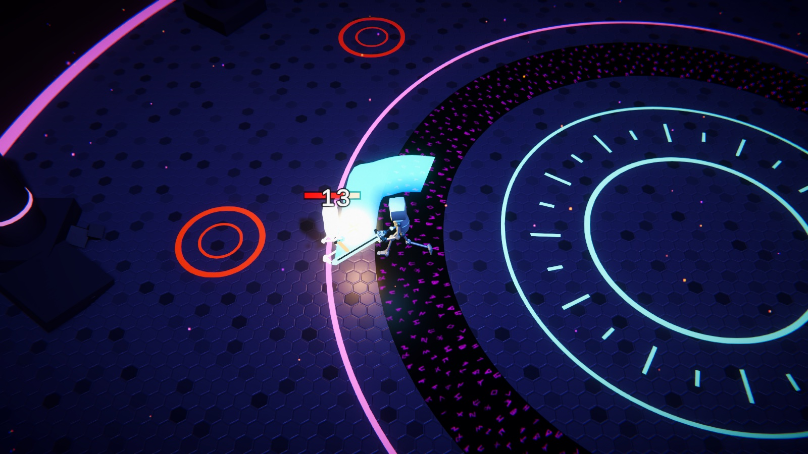
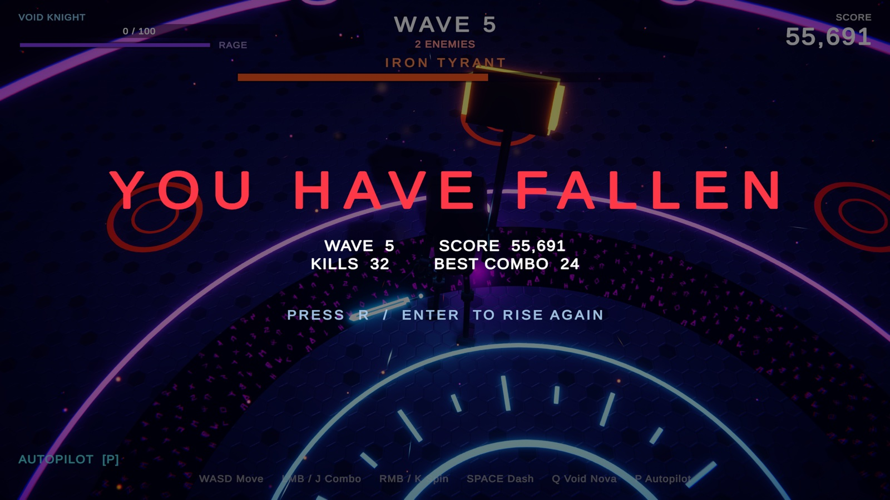

# Void Arena

A wave-based hack-and-slash arena game for **Unity 6.6 (URP)**. You fight waves of robot enemies as the Void Knight, and every fifth wave brings a boss.


## Play it

1. Open the project in **Unity 6000.6.4f1** or newer (Universal Render Pipeline).
2. In the menu bar, choose **Hack & Slash → Play Void Arena**. This opens `Assets/HackAndSlash/Scenes/VoidArena.unity` and enters Play mode.

| Input | Keyboard / mouse | Gamepad |
|---|---|---|
| Move | WASD / arrows | Left stick |
| 3-hit combo (third hit is a ground smash) | Left mouse / J | X / Square |
| Spin attack | Right mouse / K | Y / Triangle |
| Dash (dodge just before a hit for slow motion) | Space / Shift | A / Cross, RB |
| Void Nova (area attack, needs a full rage bar) | Q | B / Circle, RT |
| Autopilot (the AI plays for you) | P | — |
| Restart after death | R / Enter | Start |

## Features

- **Procedural sword combat.** The robot has no attack animation clips. Swings are generated in code and the hands follow the weapon through humanoid IK, leaving a Catmull-Rom smoothed swoosh trail.
- **Game feel:** hit-stop, screen shake, FOV punches, critical hits, floating damage numbers, chromatic-aberration pulses, slow motion on the last kill of a wave, and a "perfect dodge" slow motion.
- **Enemies:**
  - **Scrapper**: melee lunge with a dagger.
  - **Hexer**: fires homing bolts. Hit a bolt with your sword to parry it back.
  - **Juggernaut**: telegraphed ground slam. Light hits don't interrupt it.
  - **Iron Tyrant**: boss that does a triple slam, with its own health bar.
- **Systems:** escalating waves, a combo multiplier on score, health orbs that drift toward you, and a rage meter for the Void Nova.
- **Synthesized audio.** Every sound effect is generated in code at runtime. Music and footsteps come from the template's assets.
- **Code-built visuals:** particles, shockwave rings, red warning circles for slams, dash afterimages, debris, a glowing rune arena, bloom and ACES tonemapping.
- **Autopilot / attract mode.** Press P and the AI plays. After a death it restarts the run on its own.




## Project layout

```
Assets/HackAndSlash/
  Scripts/   GameManager, PlayerController, Enemy, WeaponRig (+trail, weapons), IKRelay,
             FX, Sfx, HUD, CameraRig, Projectile, HealthOrb, Spinner, Flicker
  Editor/    HackSlashBuilder: builds the whole arena scene (Hack & Slash → Rebuild Void Arena Scene)
  Scenes/    VoidArena.unity
  Materials/, Meshes/, Settings/ (post-processing volumes), Animation/ (IK-enabled animator)
```

The arena is built entirely by `HackSlashBuilder`. Change it and choose **Hack & Slash → Rebuild Void Arena Scene** to regenerate the scene.

## Credits

- The robot character, locomotion animations, textures, skyboxes, music and footstep sounds come from Unity's **Get Started** project template. That template's in-editor tutorial content is also included in this project.
- Game code, VFX, synthesized audio and the arena were built with [Claude Code](https://claude.com/claude-code) driving the Unity Editor through Unity's MCP server.
